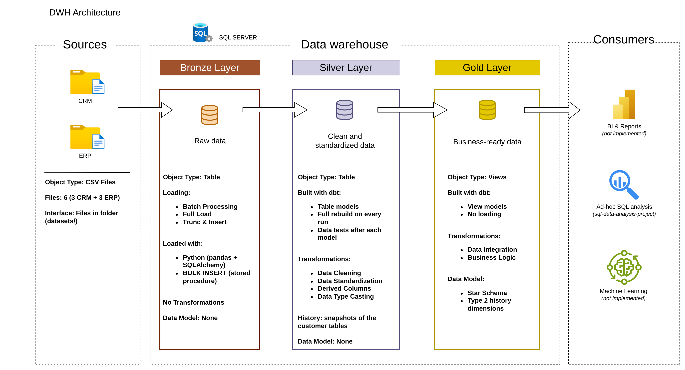
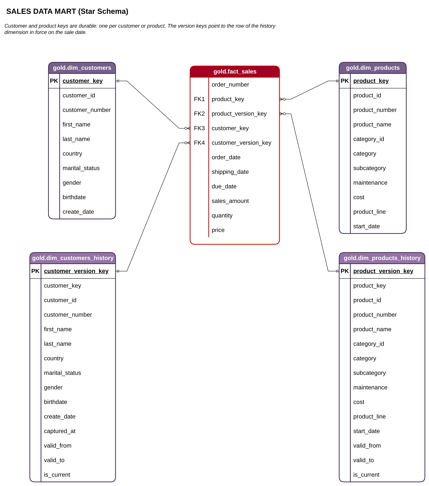
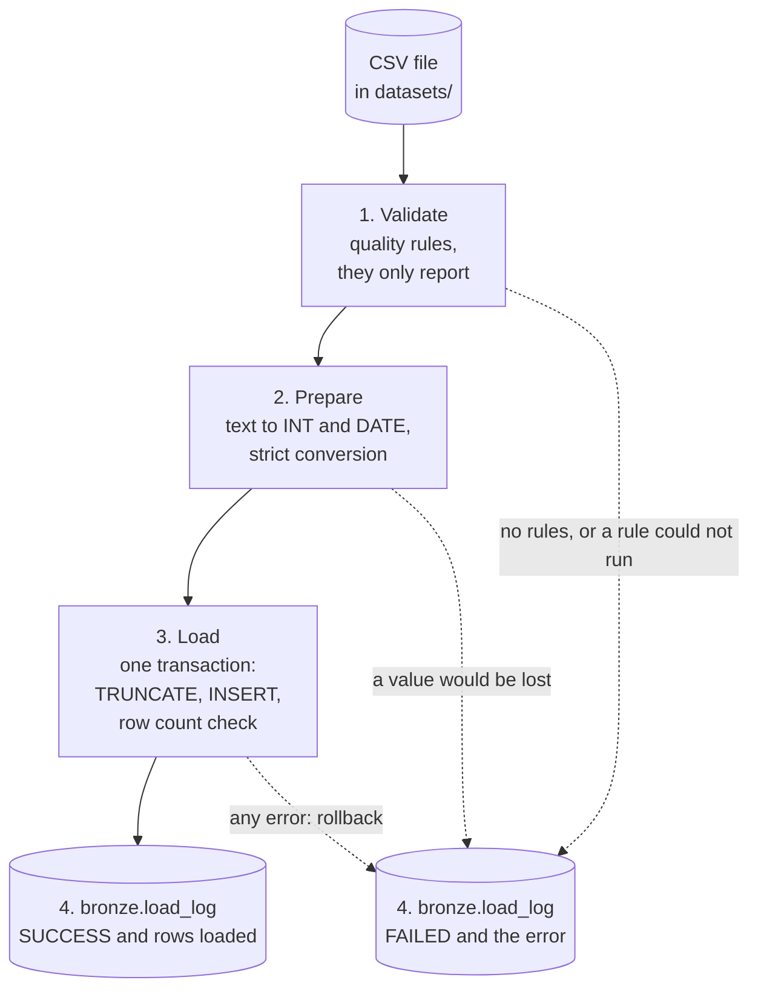

# SQL Data Warehouse Project

A data warehouse built on **SQL Server** following the **Medallion
Architecture (Bronze → Silver → Gold)**. It integrates data from two source
systems (CRM and ERP) into a dimensional star schema with type 2 history,
ready for analytical queries and BI reporting. Bronze is loaded by a Python
ingestion layer; Silver and Gold are built and tested by **dbt**.

Portfolio project built as part of my path into **Data Engineering**,
applying ETL, dimensional modeling, and data quality engineering on top of
SQL Server. The repository is fully self-contained and reproducible end to
end — clone it, load Bronze, run `dbt build`, and query a working star schema.

The Silver and Gold layers were first built with T-SQL scripts and stored
procedures, then migrated to dbt with a parity test that compared every model
with its T-SQL counterpart on each build. The T-SQL version is kept in the
git tag [`pre-dbt-cutover`](https://github.com/Teovi13/sql-data-warehouse-project/tree/pre-dbt-cutover).

---

## Architecture



The project follows the **Medallion Architecture** pattern, with three
layers that progressively refine the data:

| Layer | Purpose | Object type | Transformations |
|---|---|---|---|
| **Bronze** | Raw data, exactly as it arrives from the sources (CRM/ERP) | Tables | None (raw load with the [Python ingestion layer](#python-ingestion-layer) or `BULK INSERT`) |
| **Silver** | Cleaned and standardized data | Tables (dbt models) | Cleansing, standardization, derived columns, type casting |
| **Gold** | Business-ready data, modeled as a star schema with history | Views (dbt models) | Integration, business logic, type 2 history |
| **Snapshots** | Change history of the sources that keep only their current state | Tables (dbt snapshots) | None: each run records what changed since the previous one |

**End-to-end flow:** Sources (CSV) → Bronze (Python ingestion) → Silver → Gold (dbt) → SQL Queries / BI

The SQL analysis built on top of the Gold layer lives in a separate repository:
[sql-data-analysis-project](https://github.com/Teovi13/sql-data-analysis-project).

More diagrams available in [`docs/`](docs/):
- [`data_flow.png`](docs/data_flow.png) — data flow between tables across layers
- [`data_integration.png`](docs/data_integration.png) — how CRM and ERP are integrated
- [`star_schema.png`](docs/star_schema.png) — dimensional model of the Gold layer

---

## What this warehouse answers

The Gold layer is modeled so that simple `JOIN`s between `fact_sales` and its
two dimensions can answer real business questions without touching the
underlying source systems, for example:

- Which product categories generate the most revenue, and how has that
  shifted over time?
- Who are the highest-value customers, and which countries do they come
  from?
- How does average order value differ by customer segment (country,
  marital status)?

A fourth kind of question needs history: *which products have been
replaced, and what did each sale look like when it happened?*
`gold.dim_products_history` keeps every version of each product,
`gold.dim_customers_history` every captured change of each customer, and
each row of `gold.fact_sales` points both to the current product and
customer and to the versions in force on the sale (see
[History](data_warehouse/README.md#history-type-2)).

---

## How to run this project

**Requirements**

- **SQL Server 2017 or later** and **SSMS** (or Azure Data Studio), on **Windows**.
- **Python 3.11 or later** and the
  [Microsoft ODBC Driver 18 for SQL Server](https://learn.microsoft.com/en-us/sql/connect/odbc/download-odbc-driver-for-sql-server):
  dbt (step 3) needs them, and so does the Python option of step 2.
- Windows authentication on your SQL Server: the Python layer and the dbt
  profile below connect as the current Windows user.

The sample dataset is included in the repo, so the pipeline runs right after
cloning it:

```powershell
git clone https://github.com/Teovi13/sql-data-warehouse-project.git
cd sql-data-warehouse-project
```

> **Running the SQL scripts**
> - Run each script **in full**: press F5 with no text selected, because SSMS
>   executes only the selected text if there is any.
> - Every Bronze script starts with `USE DataWarehouse;`, so it does not
>   matter which database the query window had selected.

1. **Create the database and schemas**

   Run `scripts/init_database.sql`. It creates the `DataWarehouse` database
   and the schemas `bronze`, `silver` and `gold`, each only if it does not
   exist yet, so running it again changes nothing.
   > The script never drops the database: once dbt has run, it holds history
   > that cannot be rebuilt from the CSV files (the snapshots, and
   > `bronze.load_log`). To start from scratch, drop it by hand, knowing that
   > this history is lost.

2. **Create the Bronze tables and load them**

   First create the tables by running these scripts:
   - `scripts/bronze/ddl_bronze.sql`
   - `scripts/bronze/ddl_load_log.sql` (only needed by option A)

   Then load them with **one** of these options (both replace the whole
   content of each Bronze table, so you can switch between them):

   **A. Python ingestion layer** — validates the CSV files, loads each table
   in a single transaction and records every attempt in `bronze.load_log`.
   There are no paths to edit. From the repository root, in PowerShell:
   ```powershell
   python -m venv .venv
   .venv\Scripts\python -m pip install -r requirements.txt
   Copy-Item .env.example .env
   notepad .env
   ```
   **Edit `.env` before the first run**: set `DW_SERVER` and `DW_DATABASE`
   (see [Configuration](#configuration)). The values in the template, such as
   `your-server\your-instance`, are placeholders, not defaults. Then run:
   ```powershell
   .venv\Scripts\python -m ingestion.main
   ```
   It ends with a summary of six `SUCCESS` rows and exit code `0` (in
   PowerShell, read it with `$LASTEXITCODE`). Sample output, exit codes and
   troubleshooting: [Python ingestion layer](#python-ingestion-layer).

   **B. `BULK INSERT`** — a stored procedure with hardcoded file paths. First
   update the paths in `scripts/bronze/proc_load_bronze.sql` to point to this
   repo's local `datasets/source_crm/` and `datasets/source_erp/` folders on
   your machine. Then run that script: it only **creates** the procedure
   `bronze.load_bronze` and loads nothing yet. Finally execute the procedure:
   ```sql
   EXEC bronze.load_bronze;
   ```
   The procedure stops at the first error and re-raises it. Unlike option A,
   it is not transactional: a table whose load fails is left empty, because it
   was already truncated.

3. **Build Silver and Gold with dbt**

   dbt gets its own virtual environment, separate from the one of the Python
   layer. From the repository root, in PowerShell:
   ```powershell
   py -3.13 -m venv .venv-dbt
   .venv-dbt\Scripts\Activate.ps1
   python -m pip install -r requirements-dbt.txt
   ```
   Create `%USERPROFILE%\.dbt\profiles.yml` (outside the repository) with a
   `prod` output; the full example, with a `dev` output for development, is
   in [`data_warehouse/README.md`](data_warehouse/README.md#setup). Then, from
   `data_warehouse/`:
   ```powershell
   cd data_warehouse
   dbt debug --target prod      # ends with "All checks passed!"
   dbt deps                     # installs dbt_utils
   dbt build --target prod      # builds and tests Silver, Gold and the snapshots
   ```
   The build creates the Silver tables, the Gold views and the snapshots in
   dependency order, and runs every data test right after the model it
   checks. With the included dataset it ends with
   `PASS=96 WARN=1 ERROR=0 NO-OP=3 TOTAL=100`. The warning is expected: three
   sales have neither an amount nor a price in the source, so Silver cannot
   rebuild them (see [About the dataset](#about-the-dataset)).

4. **Validate the result**

   Every quality check already ran as a dbt test in step 3. To see the row
   count of every table:
   ```sql
   USE DataWarehouse;

   SELECT s.name AS schema_name, t.name AS table_name, SUM(p.rows) AS row_count
   FROM sys.tables AS t
   JOIN sys.schemas AS s ON s.schema_id = t.schema_id
   JOIN sys.partitions AS p ON p.object_id = t.object_id AND p.index_id IN (0, 1)
   GROUP BY s.name, t.name
   ORDER BY s.name, t.name;
   ```
   With the included dataset you should get these numbers (the 6 Silver
   tables have the same names as the Bronze ones). `bronze.load_log` also
   appears: it has one row per attempt of the Python layer, and none if you
   used `BULK INSERT`.

   | Table | Bronze | Silver |
   |---|---|---|
   | `crm_cust_info` | 77 | 70 |
   | `crm_prd_info` | 32 | 32 |
   | `crm_sales_details` | 220 | 220 |
   | `erp_cust_az12` | 59 | 59 |
   | `erp_loc_a101` | 63 | 63 |
   | `erp_px_cat_g1v2` | 5 | 5 |

   `crm_cust_info` shrinks from 77 to 70 because Silver drops the row without
   a customer id and keeps only the latest record of each duplicated customer.
   The snapshots start with one row per key: 70 in
   `snapshots.crm_cust_info_snapshot`, 63 in `snapshots.erp_loc_a101_snapshot`
   and 59 in `snapshots.erp_cust_az12_snapshot`. The Gold views return 70 rows
   in `gold.dim_customers`, 25 in `gold.dim_products` (one per product, the
   current version), 32 in `gold.dim_products_history`, 70 in
   `gold.dim_customers_history` and 220 in `gold.fact_sales`.

5. **Query the Gold layer**
   ```sql
   SELECT * FROM gold.dim_customers;
   SELECT * FROM gold.dim_products;
   SELECT * FROM gold.fact_sales;
   SELECT * FROM gold.dim_products_history;
   SELECT * FROM gold.dim_customers_history;
   ```

   From then on, each new load is two commands: the Bronze load of step 2 and
   `dbt build --target prod`. The snapshots record changes only when dbt
   runs, so how often it runs sets the resolution of the customer history.

---

## Data model (Gold Layer)

The Gold layer exposes a **star schema**: two dimensions and one fact
table, plus a history dimension for each of them.



- **`gold.dim_customers`** — customer dimension (CRM + ERP combined), current state
- **`gold.dim_products`** — product dimension, current version of each product
- **`gold.fact_sales`** — sales facts, one record per product line sold
- **`gold.dim_customers_history`**, **`gold.dim_products_history`** — one row
  per version, with its validity period. Each sale carries a version key for
  each of them, next to the keys of the current dimensions.

The diagram shows the star schema as first designed, with integer surrogate
keys; dbt builds them as MD5 hashes of the business keys and adds the history
dimensions.

Column-by-column documentation: the dbt documentation site and SQL Server
itself (see [`docs/data_catalog.md`](docs/data_catalog.md)).

Naming conventions used throughout the project: [`docs/naming_conventions.md`](docs/naming_conventions.md)

---

## About the dataset

The original CSV files used in the course this project is based on are not
included here, since they're the instructor's course material. Instead,
this repository ships with a **synthetic dataset I generated myself**
(`datasets/source_crm/`, `datasets/source_erp/`) that mirrors the exact
column structure of the original — same tables, same data types, same
naming — but every value (names, dates, IDs, prices) is fictional.

The synthetic data was deliberately built to reproduce the same data
quality problems the Silver layer is designed to fix, so the pipeline
demonstrates real, non-trivial behavior end to end rather than passing
through already-clean data:

| Issue | Where | What Silver does with it |
|---|---|---|
| Dates stored as invalid `INT` (`0`, wrong digit count) | `sales_details.csv` | Converted to `NULL` instead of failing the cast |
| Negative or missing prices | `sales_details.csv` | Recalculated from `sales / quantity` |
| Inconsistent `sales` vs. `quantity × price` | `sales_details.csv` | Recalculated to restore consistency |
| Duplicate customer records (different load dates) and one record without `cst_id` | `cust_info.csv` | De-duplicated, keeping the most recent record; the record without id is discarded |
| Multiple versions of the same product | `prd_info.csv` | Full version history kept in Silver and in `gold.dim_products_history`; `gold.dim_products` shows the current version |
| Inconsistent codes and spellings (`'S'`/`'Single'`, `'DE'`/`'Germany'`, `'US'`/`'USA'`, `'m'`/`'M'`) | multiple files | Standardized to consistent business-friendly values |
| Untrimmed and inconsistent `maintenance` flags (`' No'`, `' Yes '`, `'yes'`) | `PX_CAT_G1V2.csv` | Trimmed and standardized to `'Yes'` / `'No'` |
| Negative product costs | `prd_info.csv` | Treated as unknown, like a missing cost: set to `0` |
| Birth dates in the future | `CUST_AZ12.csv` | Set to `NULL` |
| Sales with neither `sales` nor `price` | `sales_details.csv` | Nothing to recalculate from: kept as `NULL` and reported by a dbt test as a warning |
| `NAS`-prefixed and dash-formatted customer IDs | ERP files | Stripped/normalized to match the CRM business key |

Only one of these defects survives Silver, because there is nothing to rebuild
it from: the sales with neither `sales` nor `price`. They are three sales
(SO54036, SO54051, SO54139), and the dbt test
`assert_crm_sales_details_amounts_consistent` reports them as a warning on
every build; a fourth one would turn it into an error.

---

## Repository structure

```
sql-data-warehouse-project/
│
├── datasets/                  # Source data (synthetic, included — see "About the dataset")
│   ├── source_crm/
│   │   ├── cust_info.csv
│   │   ├── prd_info.csv
│   │   └── sales_details.csv
│   └── source_erp/
│       ├── CUST_AZ12.csv
│       ├── LOC_A101.csv
│       └── PX_CAT_G1V2.csv
│
├── scripts/                   # SQL scripts for the database and the Bronze layer
│   ├── init_database.sql      # Creates the DataWarehouse database and schemas, if missing
│   └── bronze/
│       ├── ddl_bronze.sql     # Bronze table definitions
│       ├── ddl_load_log.sql   # bronze.load_log: load history written by the Python layer
│       └── proc_load_bronze.sql   # Bronze load (BULK INSERT + logging)
│
├── ingestion/                 # Python ingestion layer, with its own README
│
├── data_warehouse/            # dbt project: Silver, Gold, snapshots and data tests, with its own README
│
├── tests/                     # Unit tests of the ingestion layer (pytest, no database needed)
│
├── docs/                      # Documentation and diagrams
│   ├── data_catalog.md        # Where the documentation lives, and bronze.load_log
│   ├── naming_conventions.md  # Naming conventions used throughout the project
│   ├── data_architecture.drawio / .png
│   ├── data_flow.drawio / .png
│   ├── data_integration.drawio / .png
│   └── star_schema.drawio / .png
│
├── .env.example               # Template for the connection settings of the Python layer
├── .gitignore
├── pytest.ini
├── requirements.txt           # Dependencies to run the Python layer
├── requirements-dev.txt       # The same plus tests and code style tools
├── requirements-dbt.txt       # dbt Core and the SQL Server adapter (separate virtual environment)
├── LICENSE
└── README.md
```

---

## Python ingestion layer

The Bronze load can also be done by a Python package, [`ingestion/`](ingestion/),
that replaces the `BULK INSERT` script with a load that is repeatable,
checked and recorded. For each of the six Bronze tables it:

1. **Validates** the source CSV against data quality rules (32 in total:
   nulls, duplicates, untrimmed text, unexpected codes, impossible dates,
   `sales ≠ quantity × price`, and so on). Rules only *report*: Bronze keeps
   the data raw, and cleaning it is the job of Silver.
2. **Prepares** it: reads every column as text, then converts the integer
   and date columns to the types of the Bronze table, strictly (see
   [design decisions](ingestion/README.md#design-decisions)).
3. **Loads** it: truncates the table and inserts the rows in a single
   transaction, checks the row count, and rolls everything back on any error.
4. **Logs** the outcome of the attempt (status, rows loaded, error message)
   in `bronze.load_log`.

This is the flow for each table. The six tables are processed one after the
other, and every attempt leaves exactly one row in `bronze.load_log`:



A table that fails does not stop the others. The Silver and Gold layers are
not touched: after the Python load, continue with step 3 of
[How to run this project](#how-to-run-this-project). The requirements and the
commands to set it up and run it are in step 2, option A, of that section.

### Configuration

The connection settings are read from the `.env` file at the repository root
(it is git-ignored; create it from `.env.example`):

| Variable | Required | Default | Description |
|---|---|---|---|
| `DW_SERVER` | yes | — | SQL Server host and instance, e.g. `localhost\SQLEXPRESS` |
| `DW_DATABASE` | yes | — | Database to load, normally `DataWarehouse` |
| `DW_ODBC_DRIVER` | no | `ODBC Driver 18 for SQL Server` | Name of the ODBC driver installed on your machine. To use another version (for example 17), set it here |
| `DW_TRUST_SERVER_CERT` | no | `no` | `yes` skips the validation of the server certificate. Local development only: Driver 18 encrypts the connection, and a local server often has a self-signed certificate |

A variable already set in your shell takes priority over `.env`.

### Output and exit codes

Run it from the repository root and with `-m`, so that Python treats
`ingestion` as a package (`python ingestion\main.py` fails with
`ModuleNotFoundError`).

The **log** goes to stderr and the **summary** of the run (one row per table)
to stdout. Example with the included dataset (the log is shortened here):

```text
2026-10-14 14:16:31,083 INFO __main__: Connected to the database DataWarehouse
2026-10-14 14:16:31,115 INFO ingestion.pipeline: bronze.crm_cust_info: find_nulls({'column': 'cst_id'}) flagged 1 rows
2026-10-14 14:16:31,115 INFO ingestion.pipeline: bronze.crm_cust_info: find_duplicates({'column': 'cst_id'}) flagged 12 rows
... (24 flagged lines in total)
                   table  status  flagged error
    bronze.crm_cust_info SUCCESS        6  None
     bronze.crm_prd_info SUCCESS        5  None
bronze.crm_sales_details SUCCESS        7  None
    bronze.erp_cust_az12 SUCCESS        3  None
     bronze.erp_loc_a101 SUCCESS        2  None
  bronze.erp_px_cat_g1v2 SUCCESS        1  None
```

The exit code of the process tells whether the run worked (in PowerShell,
read it with `$LASTEXITCODE`):

| Exit code | Meaning |
|---|---|
| `0` | Every table was loaded |
| `1` | At least one table failed, or nothing was processed |
| `2` | The run could not start: a required variable is missing or the database cannot be reached. Nothing is loaded and nothing is written to `bronze.load_log` |

### Reading the result

- **`INFO … flagged N rows`**: a validation rule found N rows that break it.
  This is **not an error**: the rows are loaded anyway. The included dataset
  has deliberate defects (see [About the dataset](#about-the-dataset)), so
  24 of the 32 rules flag rows. One of them (future birth dates) depends on
  the current date, so this number can change over time.
- **`ERROR` with a traceback**: that table failed. Its previous content is
  intact (the load is rolled back) and the remaining tables were still
  processed. The reason is in the `error` column of the summary and in
  `bronze.load_log`.

The history of every attempt is in the database. For example, the last
outcome of each table:

```sql
SELECT table_name, status, rows_loaded, error_message, logged_at
FROM (
    SELECT *,
           ROW_NUMBER() OVER (
               PARTITION BY table_name ORDER BY load_id DESC
           ) AS rn
    FROM bronze.load_log
) AS ranked
WHERE rn = 1
ORDER BY table_name;
```

### Troubleshooting

| What you see | Cause and fix |
|---|---|
| Exit code 2: `Cannot connect to the database: … Error Locating Server/Instance Specified` and the message mentions `your-server\your-instance` | `.env` still has the values of the template. Replace `DW_SERVER` and `DW_DATABASE` with your own |
| Exit code 2: `Missing environment variable: 'DW_SERVER'` | `DW_SERVER` or `DW_DATABASE` is not defined. Create `.env` from `.env.example` and fill it in |
| Exit code 2: `Cannot connect to the database: … Cannot open database "…" requested by the login` | The database named in `DW_DATABASE` does not exist, or your Windows user cannot access it. Check the name and step 1 |
| Exit code 2: `Cannot connect to the database: …` mentioning the certificate or the driver | Self-signed certificate: set `DW_TRUST_SERVER_CERT=yes` (development only). Driver not found: install ODBC Driver 18, or set `DW_ODBC_DRIVER` to the name of the one you have |
| Exit code 1, every table `FAILED` with `Invalid object name 'bronze.load_log'` | `scripts/bronze/ddl_load_log.sql` was not run. The data was loaded, but the outcome could not be recorded. Run the script and run the ingestion again |

For developers: the tests, the modules, the design decisions and the known
limitations of the layer are in [`ingestion/README.md`](ingestion/README.md).

---

## dbt transformation layer

Silver and Gold are a [dbt](https://docs.getdbt.com/) project in
[`data_warehouse/`](data_warehouse/): one `SELECT` per model, built in
dependency order, with 83 data tests that stop the models built on top of a
failing one. Every model and column is documented, with a browsable site
(`dbt docs`) and the descriptions written into SQL Server, where SSMS shows
them. It adds type 2 history: product versions from the CRM, customer changes
captured by dbt snapshots, and a fact table that points to the version in
force on each sale.

The layers were first built by T-SQL scripts. The migration ran both versions
side by side, with a parity test comparing every dbt model with its T-SQL
counterpart on each build, and ended with a cutover rehearsed on a restored
copy of the database; the T-SQL scripts are kept in the git tag
`pre-dbt-cutover`. Setup, commands and design decisions in
[`data_warehouse/README.md`](data_warehouse/README.md).

---

## Technical highlights

- **Strict layer separation**, each with its own schema and single responsibility
- **dbt for Silver and Gold**: version-controlled `SELECT` models built in dependency order, each table swapped in only once it is complete, and 83 data tests that stop the models built on top of a failing one
- **Data reconciliation in Silver**: cleansing of dates stored as `INT`, recalculating price/sales when the source data is inconsistent, respecting the dependency order between calculated columns
- **Type 2 history**: product versions modeled from the CRM (whole-day validity, no gaps or overlaps, tested), customer changes captured by dbt snapshots (half-open `datetime2` validity), and a fact table with durable and version keys, so each sale can be reported with the current attributes or with those in force when it happened
- **Surrogate keys** as hashes of the business keys, so a key never shifts when other rows are added
- **Automated quality checks** as dbt tests: key uniqueness, referential integrity between the fact table and its dimensions, data consistency (`sales = quantity × price`), and the integrity of the history (one current version per key, every sale resolving to exactly one version)
- **A migration with proof**: the T-SQL and dbt versions ran side by side with a parity test on every build, and the cutover was rehearsed on a restored copy of the database before touching the real one
- **Python ingestion layer** (pandas + SQLAlchemy/pyodbc) as an alternative to `BULK INSERT` in Bronze: validation rules, strict type conversion, one transaction per table with row-count reconciliation, a persistent load history (`bronze.load_log`) and exit codes that a scheduler can act on
- **Unit-tested without a database**: a pytest suite for the Python layer, plus pycodestyle, pydocstyle and pylint checks
- **Self-contained and reproducible**: a synthetic dataset ships with the repo (see [About the dataset](#about-the-dataset)), so the entire pipeline can be run end to end on a local SQL Server, with no external service

---

## Credits

Project structure and course material based on the SQL Server course by
**Data with Baraa**. All data in this repository — the CSV files under
`datasets/` — is synthetic and generated independently; no original course
data is included or redistributed. The implementation, documentation, and
design decisions in this repository are my own.

---

## License

This project is licensed under the [MIT License](LICENSE).
