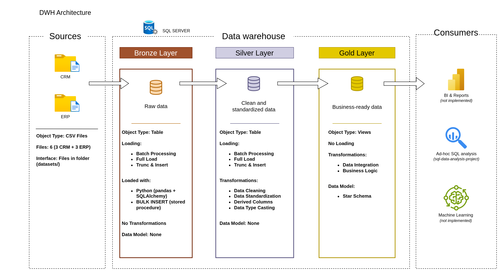
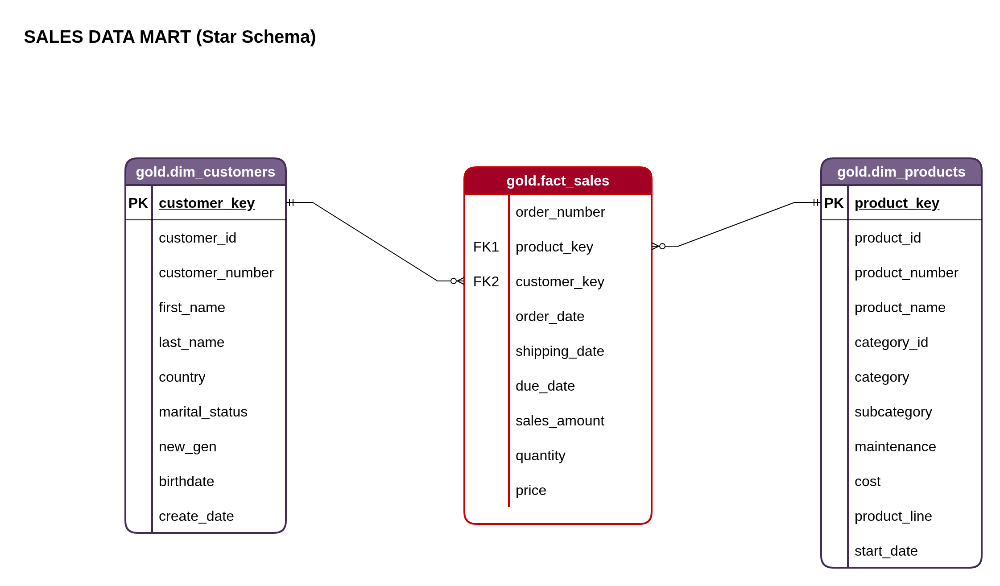
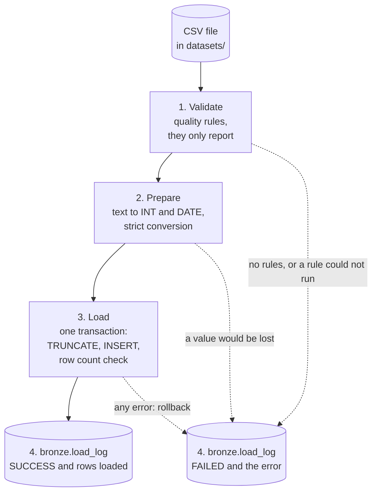

# SQL Data Warehouse Project

A data warehouse built in **SQL Server (T-SQL)** following the **Medallion
Architecture (Bronze → Silver → Gold)**. It integrates data from two source
systems (CRM and ERP) into a dimensional star schema, ready for analytical
queries and BI reporting.

Portfolio project built as part of my path into **Data Engineering**,
applying ETL, dimensional modeling, and data quality engineering on top of
SQL Server. The repository is fully self-contained and reproducible end to
end — clone it, run the scripts in order, and query a working star schema.

---

## Architecture



The project follows the **Medallion Architecture** pattern, with three
layers that progressively refine the data:

| Layer | Purpose | Object type | Transformations |
|---|---|---|---|
| **Bronze** | Raw data, exactly as it arrives from the sources (CRM/ERP) | Tables | None (raw load with the [Python ingestion layer](#python-ingestion-layer) or `BULK INSERT`) |
| **Silver** | Cleaned and standardized data | Tables | Cleansing, standardization, normalization, derived columns |
| **Gold** | Business-ready data, modeled as a star schema | Views | Integration, business logic |

**End-to-end flow:** Sources (CSV) → Bronze → Silver → Gold → SQL Queries / BI

The SQL analysis built on top of the Gold layer lives in a separate repository:
[sql-data-analysis-project](https://github.com/Teovi13/sql-data-analysis-project).

More diagrams available in [`docs/`](docs/):
- [`data_flow.png`](docs/data_flow.png) — data flow between tables across layers
- [`data_integration.png`](docs/data_integration.png) — how CRM and ERP are integrated
- [`star_schema.png`](docs/star_schema.png) — dimensional model of the Gold layer

---

## What this warehouse answers

The Gold layer is modeled so that simple `JOIN`s between `fact_sales` and its
two dimensions can answer real business questions without touching the
underlying source systems, for example:

- Which product categories generate the most revenue, and how has that
  shifted over time?
- Who are the highest-value customers, and which countries do they come
  from?
- How does average order value differ by customer segment (country,
  marital status)?

A fourth kind of question, *which products have been discontinued or
replaced, and when?*, is answered from Silver, not from Gold:
`silver.crm_prd_info` keeps every version of each product, while
`gold.dim_products` shows only the current one (see **Technical highlights**
below). Keeping that history is a detail most tutorial-level warehouses skip
entirely.

---

## How to run this project

**Requirements**

- **SQL Server** and **SSMS** (or Azure Data Studio), on **Windows**.
- Only for the Python option of step 2: **Python 3.11 or later**, the
  [Microsoft ODBC Driver 18 for SQL Server](https://learn.microsoft.com/en-us/sql/connect/odbc/download-odbc-driver-for-sql-server),
  and Windows authentication on your SQL Server (the layer connects as the
  current Windows user; SQL logins are not supported). The `BULK INSERT`
  option needs none of this.

The sample dataset is included in the repo, so the pipeline runs right after
cloning it:

```powershell
git clone https://github.com/Teovi13/sql-data-warehouse-project.git
cd sql-data-warehouse-project
```

> **Running the SQL scripts**
> - Run each script **in full**: press F5 with no text selected, because SSMS
>   executes only the selected text if there is any.
> - Every script after step 1 starts with `USE DataWarehouse;`, so it does not
>   matter which database the query window had selected.

1. **Create the database and schemas**

   Run `scripts/init_database.sql`. It creates the `DataWarehouse` database
   and the three schemas: `bronze`, `silver`, `gold`.
   > If a database named `DataWarehouse` already exists, this script **drops
   > it and creates it again**: everything in it is lost.

2. **Create the Bronze tables and load them**

   First create the tables by running these scripts:
   - `scripts/bronze/ddl_bronze.sql`
   - `scripts/bronze/ddl_load_log.sql` (only needed by option A)

   Then load them with **one** of these options (both replace the whole
   content of each Bronze table, so you can switch between them):

   **A. Python ingestion layer** — validates the CSV files, loads each table
   in a single transaction and records every attempt in `bronze.load_log`.
   There are no paths to edit. From the repository root, in PowerShell:
   ```powershell
   python -m venv .venv
   .venv\Scripts\python -m pip install -r requirements.txt
   Copy-Item .env.example .env
   notepad .env
   ```
   **Edit `.env` before the first run**: set `DW_SERVER` and `DW_DATABASE`
   (see [Configuration](#configuration)). The values in the template, such as
   `your-server\your-instance`, are placeholders, not defaults. Then run:
   ```powershell
   .venv\Scripts\python -m ingestion.main
   ```
   It ends with a summary of six `SUCCESS` rows and exit code `0` (in
   PowerShell, read it with `$LASTEXITCODE`). Sample output, exit codes and
   troubleshooting: [Python ingestion layer](#python-ingestion-layer).

   **B. `BULK INSERT`** — a stored procedure with hardcoded file paths. First
   update the paths in `scripts/bronze/proc_load_bronze.sql` to point to this
   repo's local `datasets/source_crm/` and `datasets/source_erp/` folders on
   your machine. Then run that script: it only **creates** the procedure
   `bronze.load_bronze` and loads nothing yet. Finally execute the procedure:
   ```sql
   EXEC bronze.load_bronze;
   ```
   The procedure stops at the first error and re-raises it. Unlike option A,
   it is not transactional: a table whose load fails is left empty, because it
   was already truncated.

3. **Create the tables and load the Silver layer**

   Run these two scripts, in this order:
   - `scripts/silver/ddl_silver.sql` creates the Silver tables.
   - `scripts/silver/proc_load_silver.sql` only **creates** the procedure
     `silver.load_silver`; it loads nothing yet.

   Then execute the procedure, which fills the Silver tables from Bronze:
   ```sql
   EXEC silver.load_silver;
   ```

4. **Create the Gold layer views**

   Run `scripts/gold/ddl_gold.sql`. Gold is made of views, so there is
   nothing to load: they read Silver every time they are queried.

5. **Validate the result**

   First check the row count of every table:
   ```sql
   USE DataWarehouse;

   SELECT s.name AS schema_name, t.name AS table_name, SUM(p.rows) AS row_count
   FROM sys.tables AS t
   JOIN sys.schemas AS s ON s.schema_id = t.schema_id
   JOIN sys.partitions AS p ON p.object_id = t.object_id AND p.index_id IN (0, 1)
   GROUP BY s.name, t.name
   ORDER BY s.name, t.name;
   ```
   With the included dataset you should get these numbers (the 6 Silver
   tables have the same names as the Bronze ones). `bronze.load_log` also
   appears: it has one row per attempt of the Python layer, and none if you
   used `BULK INSERT`.

   | Table | Bronze | Silver |
   |---|---|---|
   | `crm_cust_info` | 77 | 70 |
   | `crm_prd_info` | 32 | 32 |
   | `crm_sales_details` | 220 | 220 |
   | `erp_cust_az12` | 59 | 59 |
   | `erp_loc_a101` | 63 | 63 |
   | `erp_px_cat_g1v2` | 5 | 5 |

   `crm_cust_info` shrinks from 77 to 70 because Silver drops the row without
   a customer id and keeps only the latest record of each duplicated customer.
   The Gold views will return 70 rows in `gold.dim_customers`, 25 in
   `gold.dim_products` (one per product, the current version) and 220 in
   `gold.fact_sales`.

   Then run the data quality checks, one script per layer:
   - `tests/quality_checks_silver.sql`
   - `tests/quality_checks_gold.sql`

   With the included dataset, every check returns **0 rows** except one: the
   sales consistency check of `quality_checks_silver.sql` returns **2 rows**,
   sales that have neither an amount nor a price in the source, so Silver
   cannot reconstruct them (see [About the dataset](#about-the-dataset)). The
   checks that end in `SELECT DISTINCT` are not pass/fail: they list the
   values of a column (marital status, product line, gender, country,
   maintenance) so you can read them.

6. **Query the Gold layer**
   ```sql
   SELECT * FROM gold.dim_customers;
   SELECT * FROM gold.dim_products;
   SELECT * FROM gold.fact_sales;
   ```

---

## Data model (Gold Layer)

The Gold layer exposes a simple **star schema**: two dimensions and one
fact table.



- **`gold.dim_customers`** — customer dimension (CRM + ERP combined)
- **`gold.dim_products`** — product dimension (active versions only)
- **`gold.fact_sales`** — sales facts, one record per product line sold

Full column-by-column data dictionary: [`docs/data_catalog.md`](docs/data_catalog.md)

Naming conventions used throughout the project: [`docs/naming_conventions.md`](docs/naming_conventions.md)

---

## About the dataset

The original CSV files used in the course this project is based on are not
included here, since they're the instructor's course material. Instead,
this repository ships with a **synthetic dataset I generated myself**
(`datasets/source_crm/`, `datasets/source_erp/`) that mirrors the exact
column structure of the original — same tables, same data types, same
naming — but every value (names, dates, IDs, prices) is fictional.

The synthetic data was deliberately built to reproduce the same data
quality problems the Silver layer is designed to fix, so the pipeline
demonstrates real, non-trivial behavior end to end rather than passing
through already-clean data:

| Issue | Where | What Silver does with it |
|---|---|---|
| Dates stored as invalid `INT` (`0`, wrong digit count) | `sales_details.csv` | Converted to `NULL` instead of failing the cast |
| Negative or missing prices | `sales_details.csv` | Recalculated from `sales / quantity` |
| Inconsistent `sales` vs. `quantity × price` | `sales_details.csv` | Recalculated to restore consistency |
| Duplicate customer records (different load dates) and one record without `cst_id` | `cust_info.csv` | De-duplicated, keeping the most recent record; the record without id is discarded |
| Multiple versions of the same product | `prd_info.csv` | Full version history kept in Silver; only the current version surfaced in Gold |
| Inconsistent codes and spellings (`'S'`/`'Single'`, `'DE'`/`'Germany'`, `'US'`/`'USA'`, `'m'`/`'M'`) | multiple files | Standardized to consistent business-friendly values |
| Untrimmed and inconsistent `maintenance` flags (`' No'`, `' Yes '`, `'yes'`) | `PX_CAT_G1V2.csv` | Trimmed and standardized to `'Yes'` / `'No'` |
| Negative product costs | `prd_info.csv` | Treated as unknown, like a missing cost: set to `0` |
| Birth dates in the future | `CUST_AZ12.csv` | Set to `NULL` |
| Sales with neither `sales` nor `price` | `sales_details.csv` | Nothing to recalculate from: kept as `NULL` and reported by the quality check |
| `NAS`-prefixed and dash-formatted customer IDs | ERP files | Stripped/normalized to match the CRM business key |

Only one of these defects survives Silver, because there is nothing to rebuild
it from: the sales with neither `sales` nor `price`. They are the 2 rows that
the sales consistency check of `tests/quality_checks_silver.sql` reports.

---

## Repository structure

```
sql-data-warehouse-project/
│
├── datasets/                  # Source data (synthetic, included — see "About the dataset")
│   ├── source_crm/
│   │   ├── cust_info.csv
│   │   ├── prd_info.csv
│   │   └── sales_details.csv
│   └── source_erp/
│       ├── CUST_AZ12.csv
│       ├── LOC_A101.csv
│       └── PX_CAT_G1V2.csv
│
├── scripts/                   # All SQL code for the pipeline
│   ├── init_database.sql      # Creates the DataWarehouse database and schemas
│   ├── bronze/
│   │   ├── ddl_bronze.sql     # Bronze table definitions
│   │   ├── ddl_load_log.sql   # bronze.load_log: load history written by the Python layer
│   │   └── proc_load_bronze.sql   # Bronze load (BULK INSERT + logging)
│   ├── silver/
│   │   ├── ddl_silver.sql     # Silver table definitions
│   │   └── proc_load_silver.sql   # ETL Bronze → Silver (cleansing/transformation)
│   └── gold/
│       └── ddl_gold.sql       # Gold views (star schema: dims + fact)
│
├── ingestion/                 # Python ingestion layer, with its own README
│
├── tests/                     # Data quality checks (SQL) and unit tests (pytest)
│   ├── quality_checks_silver.sql
│   ├── quality_checks_gold.sql
│   └── test_*.py              # Unit tests of the ingestion layer (no database needed)
│
├── docs/                      # Documentation and diagrams
│   ├── data_catalog.md        # Data dictionary for the Gold layer
│   ├── naming_conventions.md  # Naming conventions used throughout the project
│   ├── data_architecture.drawio / .png
│   ├── data_flow.drawio / .png
│   ├── data_integration.drawio / .png
│   └── star_schema.drawio / .png
│
├── .env.example               # Template for the connection settings of the Python layer
├── .gitignore
├── pytest.ini
├── requirements.txt           # Dependencies to run the Python layer
├── requirements-dev.txt       # The same plus tests and code style tools
├── LICENSE
└── README.md
```

---

## Python ingestion layer

The Bronze load can also be done by a Python package, [`ingestion/`](ingestion/),
that replaces the `BULK INSERT` script with a load that is repeatable,
checked and recorded. For each of the six Bronze tables it:

1. **Validates** the source CSV against data quality rules (32 in total:
   nulls, duplicates, untrimmed text, unexpected codes, impossible dates,
   `sales ≠ quantity × price`, and so on). Rules only *report*: Bronze keeps
   the data raw, and cleaning it is the job of Silver.
2. **Prepares** it: reads every column as text, then converts the integer
   and date columns to the types of the Bronze table, strictly (see
   [design decisions](ingestion/README.md#design-decisions)).
3. **Loads** it: truncates the table and inserts the rows in a single
   transaction, checks the row count, and rolls everything back on any error.
4. **Logs** the outcome of the attempt (status, rows loaded, error message)
   in `bronze.load_log`.

This is the flow for each table. The six tables are processed one after the
other, and every attempt leaves exactly one row in `bronze.load_log`:



A table that fails does not stop the others. The Silver and Gold layers are
not touched: after the Python load, continue with step 3 of
[How to run this project](#how-to-run-this-project). The requirements and the
commands to set it up and run it are in step 2, option A, of that section.

### Configuration

The connection settings are read from the `.env` file at the repository root
(it is git-ignored; create it from `.env.example`):

| Variable | Required | Default | Description |
|---|---|---|---|
| `DW_SERVER` | yes | — | SQL Server host and instance, e.g. `localhost\SQLEXPRESS` |
| `DW_DATABASE` | yes | — | Database to load, normally `DataWarehouse` |
| `DW_ODBC_DRIVER` | no | `ODBC Driver 18 for SQL Server` | Name of the ODBC driver installed on your machine. To use another version (for example 17), set it here |
| `DW_TRUST_SERVER_CERT` | no | `no` | `yes` skips the validation of the server certificate. Local development only: Driver 18 encrypts the connection, and a local server often has a self-signed certificate |

A variable already set in your shell takes priority over `.env`.

### Output and exit codes

Run it from the repository root and with `-m`, so that Python treats
`ingestion` as a package (`python ingestion\main.py` fails with
`ModuleNotFoundError`).

The **log** goes to stderr and the **summary** of the run (one row per table)
to stdout. Example with the included dataset (the log is shortened here):

```text
2026-10-14 14:16:31,083 INFO __main__: Connected to the database DataWarehouse
2026-10-14 14:16:31,115 INFO ingestion.pipeline: bronze.crm_cust_info: find_nulls({'column': 'cst_id'}) flagged 1 rows
2026-10-14 14:16:31,115 INFO ingestion.pipeline: bronze.crm_cust_info: find_duplicates({'column': 'cst_id'}) flagged 12 rows
... (24 flagged lines in total)
                   table  status  flagged error
    bronze.crm_cust_info SUCCESS        6  None
     bronze.crm_prd_info SUCCESS        5  None
bronze.crm_sales_details SUCCESS        7  None
    bronze.erp_cust_az12 SUCCESS        3  None
     bronze.erp_loc_a101 SUCCESS        2  None
  bronze.erp_px_cat_g1v2 SUCCESS        1  None
```

The exit code of the process tells whether the run worked (in PowerShell,
read it with `$LASTEXITCODE`):

| Exit code | Meaning |
|---|---|
| `0` | Every table was loaded |
| `1` | At least one table failed, or nothing was processed |
| `2` | The run could not start: a required variable is missing or the database cannot be reached. Nothing is loaded and nothing is written to `bronze.load_log` |

### Reading the result

- **`INFO … flagged N rows`**: a validation rule found N rows that break it.
  This is **not an error**: the rows are loaded anyway. The included dataset
  has deliberate defects (see [About the dataset](#about-the-dataset)), so
  24 of the 32 rules flag rows. One of them (future birth dates) depends on
  the current date, so this number can change over time.
- **`ERROR` with a traceback**: that table failed. Its previous content is
  intact (the load is rolled back) and the remaining tables were still
  processed. The reason is in the `error` column of the summary and in
  `bronze.load_log`.

The history of every attempt is in the database. For example, the last
outcome of each table:

```sql
SELECT table_name, status, rows_loaded, error_message, logged_at
FROM (
    SELECT *,
           ROW_NUMBER() OVER (
               PARTITION BY table_name ORDER BY load_id DESC
           ) AS rn
    FROM bronze.load_log
) AS ranked
WHERE rn = 1
ORDER BY table_name;
```

### Troubleshooting

| What you see | Cause and fix |
|---|---|
| Exit code 2: `Cannot connect to the database: … Error Locating Server/Instance Specified` and the message mentions `your-server\your-instance` | `.env` still has the values of the template. Replace `DW_SERVER` and `DW_DATABASE` with your own |
| Exit code 2: `Missing environment variable: 'DW_SERVER'` | `DW_SERVER` or `DW_DATABASE` is not defined. Create `.env` from `.env.example` and fill it in |
| Exit code 2: `Cannot connect to the database: … Cannot open database "…" requested by the login` | The database named in `DW_DATABASE` does not exist, or your Windows user cannot access it. Check the name and step 1 |
| Exit code 2: `Cannot connect to the database: …` mentioning the certificate or the driver | Self-signed certificate: set `DW_TRUST_SERVER_CERT=yes` (development only). Driver not found: install ODBC Driver 18, or set `DW_ODBC_DRIVER` to the name of the one you have |
| Exit code 1, every table `FAILED` with `Invalid object name 'bronze.load_log'` | `scripts/bronze/ddl_load_log.sql` was not run. The data was loaded, but the outcome could not be recorded. Run the script and run the ingestion again |

For developers: the tests, the modules, the design decisions and the known
limitations of the layer are in [`ingestion/README.md`](ingestion/README.md).

---

## Technical highlights

- **Strict layer separation**, each with its own schema and single responsibility
- **Stored procedures with logging and error handling** (`TRY/CATCH` that prints the error and re-raises it, per-table duration `PRINT`) in the Bronze and Silver loads
- **Data reconciliation in Silver**: cleansing of dates stored as `INT`, recalculating price/sales when the source data is inconsistent, respecting the dependency order between calculated columns
- **Slowly Changing Dimension** for products: `silver.crm_prd_info` keeps the full version history of each product (`prd_start_dt`/`prd_end_dt` computed with `LEAD`), and `gold.dim_products` filters down to the current version only
- **Surrogate keys** generated with `ROW_NUMBER()` in the Gold dimensions, decoupling business keys from warehouse keys
- **Automated quality checks** for key uniqueness, referential integrity between the fact table and its dimensions, and data consistency (`sales = quantity × price`)
- **Python ingestion layer** (pandas + SQLAlchemy/pyodbc) as an alternative to `BULK INSERT` in Bronze: validation rules, strict type conversion, one transaction per table with row-count reconciliation, a persistent load history (`bronze.load_log`) and exit codes that a scheduler can act on
- **Unit-tested without a database**: a pytest suite for the Python layer, plus pycodestyle, pydocstyle and pylint checks
- **Self-contained and reproducible**: a synthetic dataset ships with the repo (see [About the dataset](#about-the-dataset)), so the entire pipeline can be run end to end with the SQL scripts alone, with no external dependency

---

## Credits

Project structure and course material based on the SQL Server course by
**Data with Baraa**. All data in this repository — the CSV files under
`datasets/` — is synthetic and generated independently; no original course
data is included or redistributed. The implementation, documentation, and
design decisions in this repository are my own.

---

## License

This project is licensed under the [MIT License](LICENSE).
